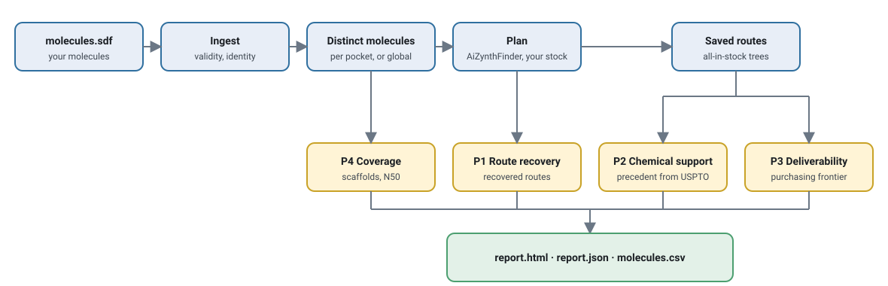

<p align="center">
  <picture>
    <source media="(prefers-color-scheme: dark)" srcset="docs/assets/synspeq_logo_dark.svg">
    
  </picture>
</p>

<p align="center">
  <b>SYN</b>thesizability through <b>S</b>tandardised <b>P</b>lanner <b>E</b>valuation and <b>Q</b>uantification<br>
  SYNSPEQ reports route recovery, chemical support, deliverability and scaffold coverage.
</p>

<p align="center">
  <a href="https://github.com/MariosGvr/synspeq/actions/workflows/tests.yml"></a>
  
  
  
</p>

---

## Overview

SYNSPEQ evaluates the synthesizability of molecule sets supplied as SDF files. It reports route recovery, retrieved
precedent support, remaining synthesis after purchasing and scaffold coverage, with counts and denominators for each
metric. Results are comparable only when the stock and planner settings are the same.

| Pillar | The question it answers | How |
|---|---|---|
| **P1 Route recovery** | Can a retrosynthesis planner find a route that ends in purchasable building blocks? | AiZynthFinder, fixed search settings |
| **P2 Chemical support** | Does each reaction in those routes have precedent in the reaction literature? | Rxn-INSIGHT retrieval against the USPTO database |
| **P3 Deliverability** | How much of the route would still have to be run, if we buy what we can? | Purchasing frontier on Enamine building blocks and REAL |
| **P4 Coverage** | Is the set diverse, or collapsed onto a few scaffolds? | Generic Bemis–Murcko scaffolds, N50, CSR-AUC |

## Quick start

**1. Install**
```bash
git clone https://github.com/MariosGvr/synspeq && cd synspeq
conda env create -f environment.yml        # includes AiZynthFinder and Rxn-INSIGHT
conda activate synspeq
```

**2. Get the data** (terms and citations are shown before each download; about 2 GB in total)
```bash
synspeq data download aizynth_zinc --dest data/aizynth --accept-terms      # planner models and the default stock
synspeq data download uspto_rxninsight_db --dest data/uspto --accept-terms # reaction database for Pillar 2
synspeq data check                         # what is installed and what each pillar still needs
```

**3. Run**
```bash
synspeq run molecules.sdf --pocket-field pocket_id --out results/    # plan with AiZynthFinder, then evaluate
```
`--pocket-field` is optional: it names an SDF property that groups molecules by target. Without it, duplicates are
removed across the whole file. Open `results/evaluation/report.html` for the report.

Planning runs a time-limited search per distinct molecule (60 s each by default), so large sets should be split over
several processes (`--workers`) or SLURM array tasks (`synspeq plan --chunk i --n-chunks N`), then evaluated with
`synspeq evaluate` on the resulting records.

**4. Add purchasing information (Pillar 3, optional)**
Pillar 3 needs a purchasing catalogue beyond the planner stock, for example Enamine building blocks (they are used as a
purchasing catalogue only; the planner stock stays AiZynthFinder's ZINC stock unless you list them under `--planner-stock`):
```bash
synspeq data import enamine_bb data/Enamine_Building_Blocks_Stock.sdf
synspeq run molecules.sdf --pocket-field pocket_id --resources enamine_bb --out results/
```
Planner records in `results/routes` and Pillar 2 reaction features are reused when a run is repeated with the same stock,
model files and settings; the summaries are recomputed. If the stock or models change, SYNSPEQ refuses to reuse the folder;
give it a new `--out`.

To evaluate saved JSON from a previous AiZynthFinder run without rerunning planning:

```bash
synspeq evaluate molecules.sdf --routes-dir aizynth_json/ --pocket-field pocket_id --out results/
```

### Try it on the demo
`examples/demo/` holds a seven-molecule SDF with hand-written planner records in AiZynthFinder's JSON layout and a
two-entry purchasing catalogue. The records illustrate the input format; they are not planner output.

```bash
synspeq data import enamine_bb examples/demo/building_blocks.smi
synspeq evaluate examples/demo/molecules.sdf --routes-dir examples/demo/routes \
    --pocket-field pocket_id --pillars P1,P3,P4 --resources enamine_bb --out demo_results/
```
```
NOTE P2: not_assessed (pillar not selected)
NOTE P3.real_needed: not_assessed (needs both the stocked and the on-demand tier)
NOTE P4.enamine_affinity: not_assessed (no reference catalogue configured)
P1  Find 83.3%  Find>=1 66.7%  distinct 6  complete=True
P3  median residual steps 1  frontier found 50.0%  needs on-demand 0.0%
P4  N50 1  unique scaffold ratio 0.250  CSR-AUC 1.000
```
The input has seven valid records and one invalid record. One molecule appears twice, so six distinct molecules
are evaluated. Outputs include the HTML report, `report.json`, per-molecule results in `molecules.csv` and resource
metadata in `run_manifest.json`. The manifest records the resources used, including their sizes and checksums.

## Reporting conventions
- **Missing resources.** Missing resources are reported as *not assessed*, *unavailable*, *bound* or *blocked*. These
  states are not reported as 0%.
- **Stock selection.** If a configured planner stock or the planner models are missing, SYNSPEQ stops without substituting
  another stock. `on_missing: skip` does not apply to them; it only lets other missing resources be marked as unavailable.
- **Denominators.** Each metric identifies the population used as its denominator: raw rows, distinct molecules or
  routed molecules.
- **Retrieved precedent is not experimental feasibility.** Pillar 2 reports retrieved precedent support. "No qualifying
  precedent" means that support was not retrieved. The 0.6412 threshold is a similarity cut-off, not a probability.
- **No third-party data is shipped.** Users supply catalogues or download them after reviewing the source terms.

## Resources
By default only AiZynthFinder's public ZINC stock is used. Additional resources must be configured:

| Resource | Used for | How you get it |
|---|---|---|
| AiZynthFinder ZINC stock (default) and models | P1 | `synspeq data download aizynth_zinc` |
| USPTO reaction database (Zenodo, CC BY 4.0) | P2 | `synspeq data download uspto_rxninsight_db` (checksum verified) |
| ZINC20 tranches, ASKCOS buyables | alternative planner stocks | guided import |
| Enamine building blocks | P3 stocked tier | download from Enamine, then `synspeq data import` |
| Enamine REAL | P3 on-demand tier, P4 reference | request from Enamine, then `synspeq data import` |
| eMolecules, Molport | alternative planner stocks | your own account or agreement |

`synspeq data info <id>` prints the source, terms and citation for each resource. See
[docs/DATA_RESOURCES_GUIDE.md](docs/DATA_RESOURCES_GUIDE.md) for resource requirements and file formats. The guide also
describes missing-resource handling.

| If you… | SYNSPEQ… |
|---|---|
| never mention REAL | reports the REAL-dependent numbers as *not assessed* and runs |
| list REAL but the path is wrong | stops with the exact fix (or continues with *unavailable* under `on_missing: skip`) |
| have only part of REAL scanned | reports *bounds* and says how much was covered |
| have the default stock and the USPTO database | evaluates P1, P2 and P4; P3 needs a catalogue beyond the planner stock |

## How it works
<p align="center"></p>
P1 requires planner models and a stock. P2 requires the USPTO database. P3 requires a purchasing catalogue. P4's
scaffold metrics require no additional catalogue.

- **Identity** is the RDKit canonical isomeric SMILES as read. No cleanup is applied. Invalid records are listed with a reason.
- **Routes**: analysis uses returned routes whose leaves are all in stock. The primary route is the first such route in planner order.
- **Pillar 3** stops each branch at its first catalogue-listed molecule and counts the remaining reactions.

## Commands
| Command | What it does |
|---|---|
| `synspeq run` | plan with AiZynthFinder, then evaluate (SDF → report) |
| `synspeq plan` | planning only; resumable, splits into chunks for SLURM arrays |
| `synspeq evaluate` | all assessable pillars from cached planner records |
| `synspeq validate` | input audit: valid / invalid, raw and distinct counts |
| `synspeq data list \| info \| import \| check \| download \| build-union` | manage resources; `build-union` merges your catalogues into one planner stock |
| `synspeq real-scan` / `real-merge` | one-pass REAL lookup of route intermediates |
| `synspeq scaffold-prior` | P4 reference scaffold prior from a REAL sample |
| `synspeq report` | re-render `report.html` from `report.json` |

## Installation options
```bash
conda env create -f environment.yml        # full: planner + Pillar 2 (recommended)
conda env create -f environment-core.yml   # core: ingestion, P1 replay, P3, P4
pip install -e .                           # into an environment you already manage
```
`environment.yml` installs AiZynthFinder and Rxn-INSIGHT with pip inside the conda environment. The environment pins
RDKit 2023.09, numpy < 2 and pandas < 3 for compatibility with AiZynthFinder 4.4.1. A conda-build recipe for the
core package is in [`conda/`](conda).

## Status
Early development. All four pillars and live planning are implemented, and the package produces an HTML report.
Multi-population comparison plots and a PyPI / conda-forge release are planned.
v1 does not include analysis of generator-supplied routes or Chemformer.

## Contributing and testing
```bash
python -m unittest discover -s tests/unit -t .     # 45+ tests, no network, no third-party data
```
Issues and pull requests are welcome.

## Acknowledgements
SYNSPEQ builds on [AiZynthFinder](https://github.com/MolecularAI/aizynthfinder) (MIT),
[Rxn-INSIGHT](https://github.com/mrodobbe/Rxn-INSIGHT) (MIT), [RXNMapper](https://github.com/rxn4chemistry/rxnmapper) (MIT),
[RDKit](https://www.rdkit.org) (BSD), the USPTO reaction data distributed with Rxn-INSIGHT (CC BY 4.0) and the ZINC database.
Cite the works corresponding to the components you use. `synspeq data info <id>` lists their references.

## Licence
Copyright 2026 The SYNSPEQ authors. Released under the [Apache License 2.0](LICENSE).
The licence covers SYNSPEQ's code only. Third-party software and data (AiZynthFinder, Rxn-INSIGHT, ZINC, Enamine,
eMolecules, Molport, REAL, the USPTO database) remain under their own terms, which you must follow.
